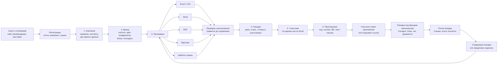

# Путь клиента платформы (21.10.2026)

Как организатор деловых поездок — турагентство, MICE-агентство, экспортный центр — начинает пользоваться платформой
и как его участники получают приложение под его брендом. Решение пользователя 21.10.2026: «пустой кабинет», загрузка
программ из Excel, PDF, Word и вручную, работа с компьютера, планшета и телефона.

## Схема

## Шаги и где их делает клиент

| Шаг | Кто | Где | Что готово сейчас (показ в браузере) | Что добавит сервер |
| --- | --- | --- | --- | --- |
| Регистрация | руководитель организатора | сайт платформы | — (кабинет открывается сразу) | вход по почте, пробный период, оплата |
| 1. Компания | руководитель | компьютер, планшет, телефон | название, контакты, регион данных | договор, реквизиты |
| 2. Бренд | руководитель или маркетолог | компьютер, планшет | логотип, цвет, координатор, блоки, плитки, вкладки + живой предпросмотр | общий бренд для всех устройств команды |
| 3. Программы | менеджер программ | компьютер, планшет | Excel/CSV, Word, PDF, вручную, шаблон 9 стран; проверка перед сохранением | библиотека программ команды, разбор сложных PDF на сервере |
| 4. Поездка | менеджер | компьютер, планшет | даты, отель, публикация участникам | несколько выездов одной программы, изменения с уведомлениями |
| 5. Участники | менеджер | компьютер | вручную или из Excel | анкеты участников, согласия, хранение в регионе клиента |
| 6. Приглашение | менеджер, координатор | любое | код, ссылка, настоящий QR-код, текст письма | рассылка по почте и в мессенджеры, статус «открыл» |
| В поездке | участник, координатор | телефон | все экраны приложения в бренде организатора | синхронизация, push-уведомления, чат через сервер |

## Что видит новый клиент

- **Пустой кабинет.** Программ и поездок GTT у нового организатора нет: на стартовом экране — «Кабинет организатора» и
  «Пример поездки» (вымышленная поездка с вымышленными участниками, чтобы посмотреть, как всё работает).
- **Каждый шаг — с предпросмотром.** Справа (на телефоне — по кнопке «Предпросмотр») — телефон участника в цветах
  бренда: вход, «Сегодня», «План».
- **Файлы разбираются на устройстве.** Excel и Word — в любом браузере и в приложении; PDF — в браузере (pdf.js лежит
  рядом с сайтом). Сканы-картинки не читаются — для них ручной ввод или Excel.

## Как участник попадает в поездку

1. Получает от организатора письмо или сообщение со ссылкой и кодом, либо сканирует QR-код на брифинге.
2. Открывает ссылку в браузере или ставит общее приложение и вводит код.
3. Видит поездку под брендом организатора: стартовый экран с логотипом, «Сегодня», «План», чат с координатором.

До подключения сервера код и ссылка работают на том устройстве, где собран кабинет; это показ. С сервером — на любом.
